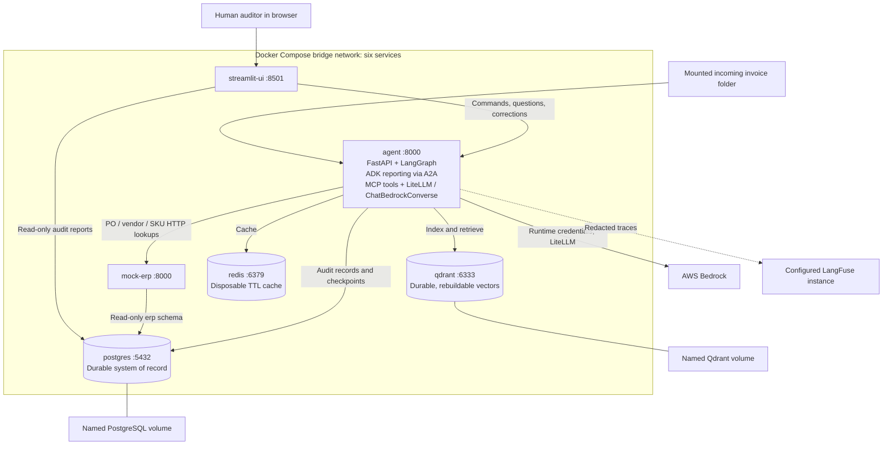
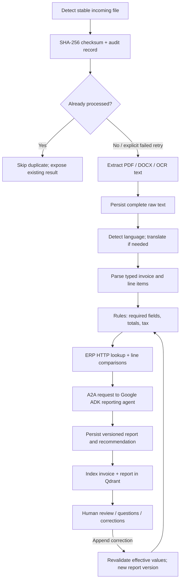
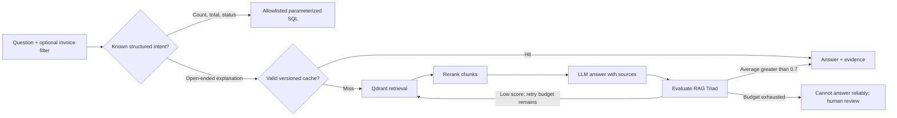

# AI Invoice Auditor: proposed architecture and team plan

Status: IMPLEMENTATION STARTED. See BUILD_STATUS.md for verified checks and pending integration. The diagram and plan below are the design baseline.

Source: Capstone_AI_Invoice_Auditor.pdf, all 15 pages, including Part II (containerized extension). This design combines the original requirements with the extension; the extension does not remove Google ADK, A2A, MCP, Responsible AI or LangFuse.

## 1. Project kya hai?

Ek logistics company ko vendors bills bhejte hain. Bill PDF, Word document ya scanned image ho sakta hai, aur English, Spanish ya German mein ho sakta hai. Employee ko bill padhkar check karna padta hai ki company ne jo order diya tha, bill uske according hai ya nahi.

Hum ek assistant banayenge jo invoice padhega, English mein normalize karega, company ke purchase order se compare karega, aur report dega. Human auditor report review karega, extraction mistakes correct karega aur invoice ke baare mein questions pooch sakega.

Invoice = vendor ka bill. Purchase order (PO) = company ne pehle kya kharidne ka order diya tha. ERP = company ke orders, vendors aur products ka business system. Hum real ERP ki jagah small mock ERP API banayenge.

### Example

PO-1001 mein 10 boxes, each INR 100, ordered hain. Invoice mein 10 boxes, each INR 120, total INR 1,200 likha hai. Invoice ki internal arithmetic correct hai, but approved PO ke comparison mein unit price 20% zyada hai. System item code ke basis par matching karega, mismatch store karega aur configured rule ke according review/reject recommend karega.

Auditor pooch sakta hai: "Why was this invoice flagged?" Answer invoice/report ke evidence se aayega: "The billed unit price is 120, whereas the purchase order price is 100." Evidence source bhi visible hoga.

This is an audit recommendation tool. It does not make payments or prove fraud. A mismatch may be a billing error, an extraction error or a legitimate change needing human review.

## 2. Scope and simplicity decisions

- Streamlit UI, Python backend, FastAPI APIs. No React build required.
- One main LangGraph workflow, and a small Google ADK reporting agent inside the same agent container.
- Agents are named processing roles with clear inputs/outputs; every role does not need an autonomous conversation loop.
- Simple functions, Pydantic data models, explicit SQL and a small repository layer. No unnecessary class hierarchy or generic plugin framework.
- Decimal arithmetic for amounts, quantities and tolerances. LLM explanations cannot override computed discrepancies.
- Folder monitoring is implemented; live mailbox integration is design-only as permitted by the brief.
- Core demo supports PDF, DOCX and PNG; multilingual fixtures initially cover English, Spanish and German. Extensible design does not mean guaranteed support for every language/layout.
- Six Compose services remain fixed. LiteLLM is an in-process library. ADK, A2A and MCP endpoints run within the agent service, without adding deployment containers.
- Bedrock credentials, region and model access are runtime prerequisites. The exact accessible model identifiers will be verified before implementation. Models named in the brief are the initial targets, not an assumption that every account has access.

## 3. Deployment HLD



Only agent writes business/audit application data. ERP data is seeded automatically at database initialization; mock-erp subsequently reads it. UI database access is read-only. UI corrections go through agent API. Agent and UI never query ERP tables directly.

Internal URLs use service names, for example `http://mock-erp:8000`, not localhost or fixed IP addresses. Host access: UI 8501, agent 8000, mock ERP 8001, PostgreSQL 5432, Qdrant 6333, Redis 6379, as specified in the brief.

LangFuse is a required observability integration but not one of the specified six containers. Proposed deployment uses an externally available LangFuse instance. This is a clarification to the brief's statement that Bedrock is the only external dependency: external LangFuse is another endpoint. If the lab requires self-hosted LangFuse, its infrastructure must be approved as an addition to the six-service target. Do not silently omit tracing.

## 4. Invoice workflow and framework boundaries



Main orchestration uses LangGraph. Monitor, extractor, translation, completeness, business validation and indexing are explicit nodes. Google ADK owns report explanation/synthesis. Its agent card and task/message interface use an actual compatible A2A SDK; arbitrary JSON between Python functions will not be called A2A. LangGraph calls this ADK service through A2A on an internal route of the agent service.

MCP exposes named tools for document harvesting, language bridge, completeness checks, ERP comparison, report creation and RAG operations. Use an in-process managed MCP server over stdio in the agent container, discovered through an MCP client. Protocol adapters stay small and separate from business functions. Tool calls must use real MCP discovery/invocation; renaming Python functions is insufficient.

The reporting agent receives computed findings and a proposed policy outcome. It produces explanation, not independent financial decisions. A deterministic report builder validates its output and writes JSON/HTML. If synthesis fails, a clearly marked template report can still show verified findings.

### Failure handling

- Wait until file size/mtime is stable before reading a newly copied file.
- Unique checksum protects against concurrent duplicate processing. Distinguish exact binary duplicates from semantic duplicates such as a rescan of the same vendor invoice number.
- Record detected, processing, awaiting_review, completed and failed states, with error details and retry count.
- Explicit retry resumes/reprocesses a failed record; deduplication must not permanently block failed invoices.
- Unsupported or unreadable files remain visible as failed records.
- Missing PO or ambiguous SKU match requires review; do not guess matching by line order.
- Persist raw text before expensive downstream calls; bounded retries for transient failures.
- Checkpoints preserve workflow state; durable audit tables preserve business history.
- RAG indexing failure is recorded separately from invoice audit success and can be retried.
- Start with a single watcher/worker; scaling requires database claim/locking and shared file storage. Multiple watchers cannot safely be added without coordination.

## 5. Agent and tool map

| Agent role | Framework | Tool / main behavior |
|---|---|---|
| Invoice Monitor | LangGraph node | Invoice-Watcher: stable file detection, checksum, routing |
| Extractor | LangGraph node | Data Harvester: pdfplumber, python-docx, Tesseract fallback |
| Translation | LangGraph node | Lang-Bridge: language detection, Bedrock via LiteLLM custom adapter and ChatBedrockConverse, caching |
| Invoice Data Validation | LangGraph node | DataCompletenessChecker: YAML rules, totals and taxes |
| Business Validation | LangGraph node | Business Validation Tool: ERP HTTP lookup and comparisons |
| Reporting | Google ADK via A2A | Insight Reporter: evidence-based explanation and report synthesis |
| Indexing | LangGraph node | Vector-Indexer: chunk, embed, upsert Qdrant |
| Retrieval | LangGraph node | Semantic-Retriever: filtered vector search |
| Augmentation | LangGraph node | Chunk-Ranker: deduplicate, rerank, assemble context |
| Generation | LangGraph node | Response-Synthesizer: grounded answer via LiteLLM |
| Reflection | LangGraph node | RAG-Evaluator: answer relevance, context relevance, groundedness |

Validation agents use LLM assistance for interpreting uncertain fields and explaining findings, as required by the brief. Numerical pass/fail checks remain explicit Python functions. Indexing/retrieval use embeddings and ranking; generative LLM calls are added only where their role requires them.

## 6. RAG explained and designed

RAG = Retrieval-Augmented Generation. Instead of asking AI to remember an invoice, we first find the relevant saved invoice/report passages and give those passages to AI with the question.

Embedding = text represented as numbers for similarity search. Chunk = a small passage with its source metadata. Vector DB = the index used to find similar passages.



Plan: one initial generation plus at most three retries, explicitly matching the brief's word "retries". Each retry broadens/rephrases retrieval while retaining the user's invoice scope. Never retry indefinitely or show a low-scoring answer as verified.

Reflection scores are model-assisted quality signals, not guarantees of truth. Use a small human-reviewed evaluation dataset to check their usefulness. Absent evidence means abstention. Show invoice ID, report version and chunk references with answers.

For simple totals/counts, use fixed supported query intents with parameterized SQL; do not execute unrestricted LLM-written SQL. For reranking, start with a clear scoring function or available Bedrock ranking capability; keep its input/output contract explicit. Choose an accessible Bedrock embedding model so no separate external embedding service is required.

Cache keys include normalized question, invoice/scope, report version or corpus revision, model and prompt version. A correction or new report invalidates old answers. Cache translation by text hash, language and translation model/prompt version. Set TTLs for every key.

## 7. Data design and history

| Store | Contents | Durability |
|---|---|---|
| Mounted filesystem | Original PDF/DOCX/PNG and optional exported reports | Retained while mounted storage exists |
| PostgreSQL `audit` | Extracted/translated text, typed invoices, lines, findings, report history, corrections | Named volume; authoritative |
| PostgreSQL `erp` | Vendors, PO headers/lines, SKU master | Named volume; mock-erp owns reads |
| PostgreSQL `langgraph` | Persistent workflow checkpoints | Named volume; checkpointer manages structure |
| Qdrant | Chunks, embeddings and metadata | Named volume; rebuildable from PostgreSQL |
| Redis | Translation and answer caches | Disposable; no durable state |

Proposed audit tables:

- `invoice_audit`: UUID, checksum UNIQUE, file path, extraction method, raw text, translation, language, confidence metadata, invoice/vendor/PO fields, date/currency/totals, processing status/error, thread ID and timestamps.
- `invoice_line_items`: invoice FK, line number, item code, description, quantity, unit price, line total and optional tax fields. Separate rows, not one JSON array.
- `audit_runs`: invoice FK, run/version number, rules version, effective input snapshot, recommendation, JSON report, HTML report and timestamps.
- `discrepancies`: audit run FK, invoice/line reference, field, actual value, expected value, absolute/percentage deviation, severity and rule ID.
- `human_feedback`: invoice/line reference, original value, corrected value, reviewer identity, reason, timestamp and resulting revalidation run.
- `rag_index_status`: invoice/report version, embedding model version and indexing state/error; enables recoverable reindexing.

Human corrections are append-only. The original extraction is never overwritten. Effective values are derived by applying accepted corrections; every revalidation creates a new audit run. Original and latest reports remain inspectable.

Money uses PostgreSQL NUMERIC and Python Decimal, dates use DATE/TIMESTAMPTZ, variable extras use JSONB. Persist report text in PostgreSQL so Qdrant can be rebuilt without original files, OCR, translation or repeated report generation.

Qdrant collection payload: `invoice_id`, `chunk_text`, `source_type`, `vendor`, `language`, `report_version`, `chunk_id`. Replace obsolete active vectors when revalidating; preserve historical reports in PostgreSQL. Similarity filters and cache versions must agree on active report version.

## 8. Rules, confidence and recommendations

`configs/rules.yaml` contains required fields, matching keys, quantity/price tolerances, tax rules, rounding tolerance and severity-to-recommendation policy. Missing required data -> review; material validated mismatches -> reject according to configured policy; complete matching data -> approve recommendation.

These are demo business policies, not universal tax or accounting rules. Document fixtures' tax assumptions. Include subtotal, discounts, freight, tax and rounding when available; do not assume every invoice total equals only quantity times unit price.

Do not invent missing PO numbers, item codes or prices. Keep unknown fields null, with review findings. Use bounded structured-output parsing retries.

Translation confidence must be shown with its method and limitations. A model's self-reported confidence is not a calibrated probability. Preserve original text, translated text and diagnostics; low-confidence critical fields route to review. Confirm exact thresholds against the demonstration dataset.

## 9. Proposed API contracts

| Endpoint | Purpose |
|---|---|
| `GET /health`, `GET /ready` | Process liveness and dependency readiness |
| `POST /invoices` | Safely accept an upload into the incoming folder |
| `GET /invoices/{id}` | Invoice details, status and effective values |
| `GET /invoices/{id}/reports` | Report version history |
| `POST /invoices/{id}/corrections` | Append human feedback and trigger revalidation |
| `POST /invoices/{id}/retry` | Explicit bounded failed-job retry |
| `POST /questions` | Question, optional invoice scope -> answer, evidence, evaluation |
| `POST /index/rebuild` | Explicit operator action to reconstruct Qdrant from stored text |
| ERP `GET /po/{po_number}` | PO header and items |
| ERP `GET /vendor/{vendor_id}` | Vendor master |
| ERP `GET /sku/{sku_code}` | Product master |

Schemas should reject invalid correction types and unsafe filenames. Final A2A routes/card and MCP tool schemas will follow the selected SDK versions, verified during implementation.

## 10. Responsible AI and observability

- Treat invoice text as untrusted data, not instructions to the agent. Documents cannot request arbitrary tools, URLs or SQL.
- Allowlist tool operations and ERP destinations; validate input sizes, file extensions and actual parseability. Escape invoice text in HTML reports.
- Keep credentials out of source, images, reports and logs. Supply runtime values through ignored environment configuration; provide `.env.example` with placeholders.
- Separate PostgreSQL permissions: UI audit read-only, ERP erp read-only, agent audit/checkpoints writes. Database initialization is the schema/seed exception.
- Redact sensitive invoice content in LangFuse by default; trace IDs, stage, latency, model usage, errors, retries, retrieval IDs and evaluation scores remain useful.
- Preserve reviewer identity and correction history; cap model calls and retries. A demo reviewer selector is not production authentication, and will be documented as such.
- Health checks and dependency checks fail clearly. Redis data loss must only affect speed. Required service unavailability appears clearly in readiness/UI.

## 11. Four-member contribution plan

Names are placeholders; ownership can be assigned after review. Each person owns working backend code, a meaningful user-visible feature, focused verification and viva explanation. Shared integration does not imply fabricated authorship; contribution records will reflect actual reviewed work.

| Member | Main module | Proposed owned files | What they demonstrate/explain |
|---|---|---|---|
| 1 | Invoice ingestion and multilingual extraction | `agent/ingestion/watcher.py`, `extractor.py`, `translation.py`, `parser.py`; extraction/translation prompts; ingestion tests | PDF vs OCR, DOCX parsing, checksums, structured extraction, confidence and language handling |
| 2 | ERP and invoice validation | `mock_erp/main.py`, `repository.py`; `db/erp_schema.sql`; `agent/validation/completeness.py`, `business.py`, `policy.py`; `configs/rules.yaml`; validation tests | PO matching, APIs, Decimal/tolerances, missing fields, deterministic recommendations |
| 3 | RAG and grounded question answering | `agent/rag/indexer.py`, `retriever.py`, `ranker.py`, `generator.py`, `reflection.py`, `graph.py`; RAG prompts/evaluation fixtures | Embeddings, Qdrant, SQL vs RAG routing, reranking, triad, retry loop, answer caching |
| 4 | Human review, ADK reporting and audit history | `ui/app.py`, `ui/pages/*`; `agent/reporting/adk_agent.py`, `report_builder.py`; `agent/api/corrections.py`; correction/report repository functions; report templates and feedback tests | Dashboard, A2A reporting, correction history, report versions and revalidation |

Shared integration ownership, so DevOps/protocol work does not fall on one person:

| Area | Primary | Reviewer |
|---|---|---|
| LangGraph invoice graph, main API and checkpoint wiring | Member 1 | Member 3 |
| Common Pydantic contracts and audit SQL schema | Member 2 | Member 4 |
| MCP server/client and tool adapters | Member 3 | Member 1 |
| A2A integration and trace setup | Member 4 | Member 2 |
| Agent Dockerfile and OCR packages | Member 1 | Member 2 |
| Mock ERP Dockerfile and seed initialization | Member 2 | Member 1 |
| Qdrant/Redis services and rebuild verification | Member 3 | Member 4 |
| UI Dockerfile and final Compose integration | Member 4 | Member 3 |

This is an initial balance by responsibility, not a promise of equal lines of code. Rebalance after the first vertical slice if one module needs substantially more work. All four must understand the complete invoice journey and the architecture diagram.

## 12. Documentation to maintain during implementation

```text
docs/
  ARCHITECTURE_AND_TEAM_PLAN.md
  PROJECT_EXPLANATION.md
  SETUP_AND_DEMO.md
  API_AND_DATA_MODEL.md
  VERIFICATION_RESULTS.md
  VIVA_GUIDE.md
  CONTRIBUTIONS.md
  members/
    MEMBER_1_CODE_GUIDE.md
    MEMBER_2_CODE_GUIDE.md
    MEMBER_3_CODE_GUIDE.md
    MEMBER_4_CODE_GUIDE.md
```

Each member guide will contain actual contribution, file paths, important functions, input/output examples, readable walkthroughs, dependencies, failure behavior, verification evidence and viva Q&A. Include short code excerpts where helpful, with the executable source files as the authoritative complete code. Do not maintain a second manually copied implementation in Markdown.

`CONTRIBUTIONS.md` maps requirement -> actual author/contributor -> code file -> explanation guide -> verification evidence. Update it as work lands. Current ownership is only a plan; no implementation contribution is claimed yet.

Proposed remaining tree: `agent/{api,workflow,ingestion,validation,reporting,rag,tools,storage,prompts}`, `mock_erp/`, `ui/`, `db/`, `configs/`, `data/samples/`, `tests/`, three Dockerfiles/three .dockerignore files, root `compose.yaml`, `.env.example`, README and dependency lock/pin files. Each module should stay short enough to read and explain independently.

## 13. Implementation phases after design approval

1. Agree shared schemas/contracts, sample invoices, rules and expected outcomes. Create a requirements-to-evidence checklist.
2. Build mock ERP, PostgreSQL seed and basic UI shell; validate their containers independently.
3. Build a vertical slice: one English invoice -> extraction -> ERP comparison -> stored JSON/HTML report -> UI. Wire the LangGraph orchestration and real protocol integration incrementally.
4. Add scanned PDF/PNG, DOCX, Spanish/German translation and low-confidence review paths.
5. Add Qdrant indexing, SQL query intents, full LangGraph RAG stages, reflection and bounded retries.
6. Add correction/revalidation history, caching invalidation, LangFuse traces and guardrails across workflows.
7. Finish single-command Compose startup, persistence/rebuild checks and each member's documentation. Prepare up to five presentation slides.

Build incrementally, but the final submission includes all required features. A stubbed/offline model demo must be visibly labeled and cannot count as the required Bedrock/ADK/A2A/MCP implementation.

## 14. Verification and demo evidence

- One-command startup after documented runtime configuration; all six services healthy; seed data loads automatically on a fresh database.
- PDF text extraction; scanned PDF and PNG OCR fallback; DOCX; English/Spanish/German fixtures with expected fields.
- Matching invoice, wrong unit price, wrong quantity, missing field, wrong tax, missing PO, ambiguous item and duplicate input.
- ERP comparison trace proves HTTP service use, not direct ERP SQL.
- Correction inserts feedback, preserves extraction, creates a new report and refreshes RAG/cache scope.
- RAG answers show evidence; invoice filters isolate documents; unanswerable questions abstain; reflection stops after configured retries.
- Destroy/recreate containers retaining volumes: reports and indexed questions still work without reprocessing.
- Flush Redis: correct results still work. Delete only Qdrant storage in a disposable test environment: rebuild from PostgreSQL without OCR or translation.
- Destructive `down -v` verification only on an isolated test stack: audit/vector stores become empty after recreation. Retained incoming files must be withheld or watcher paused for this check, otherwise automatic reingestion can hide the empty state. ERP seeds may reappear by design.
- Inspect built image history and build context for secret safety; never print real credentials in screenshots or demo logs.
- Prove service-name discovery, non-root images, dependency readiness and explicit image tags.
- Check A2A agent discovery/invocation, MCP list/call behavior and redacted LangFuse traces with saved evidence.

## 15. Inputs to resolve before the affected implementation

The uploaded PDF references a separate `Masked Invoice.pdf` and `erp_schema.sql`; these files are not included in the provided attachment. Synthetic multilingual samples and a compatible mock ERP schema can be created if those originals are unavailable, clearly identified as team-created fixtures.

Need during implementation: member names for attribution; available AWS Bedrock region/model access and runtime credentials supplied privately; NuvePro lab Docker/resources/network constraints; available LangFuse endpoint. None is needed to review this HLD. No credentials should be pasted into documentation.

The PDF has no separate rendered architecture figure accessible in its text; it describes an embedded object. The diagram above is our proposed design reconstructed from the explicit service and flow requirements, not a claimed reproduction of that embedded object.

## User-authorized laptop profile (2026-10-27)

AWS is currently accessible only on office laptops. A temporary Groq local development profile is implemented; see LOCAL_QUICKSTART.md. It shares contracts, financial rules, prompts and report formatting with this design. It does not replace the six-service Bedrock capstone architecture above. Groq is an explicit user override for local development, not a claim that the original document allows Groq in the final submission.
