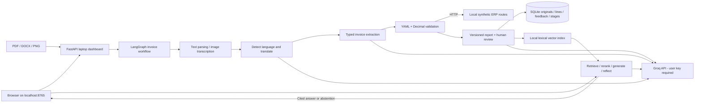

# Temporary laptop architecture

This is the local development profile. The final HLD remains HLD_ARCHITECTURE.png with Bedrock, PostgreSQL, Qdrant, Redis, MCP and ADK/A2A. Local lexical vectors do not replace the final semantic-embedding requirement.
