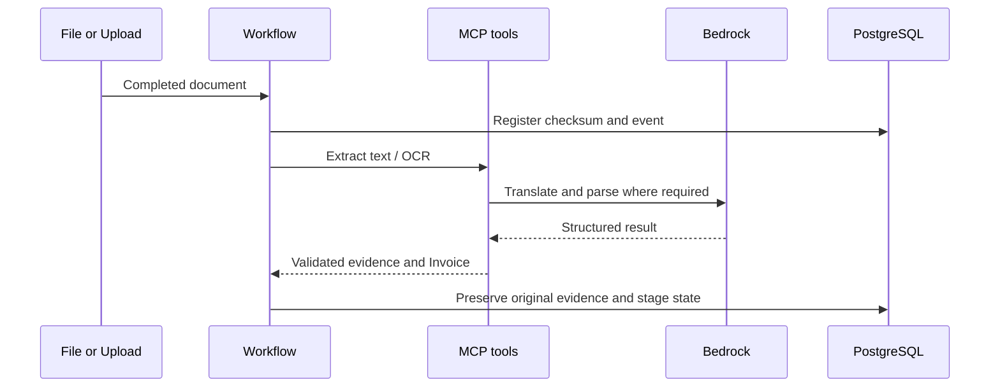

# Member 1: Document intelligence

## Your responsibility

Explain how a heterogeneous document becomes a complete, validated Invoice object while preserving original evidence. Own intake/file detection, checksum deduplication, digital text extraction, OCR routing, language detection, translation and structured parsing. Coordinate schema changes with Member 2 and prompts/model configuration with Member 3.

## Read these files in order

1. scripts/make_samples.py: understand synthetic fixtures and expected price/quantity differences.
2. agent/models.py: Invoice and LineItem contracts, Decimal amounts and optional extracted fields.
3. agent/extraction.py and agent/translation.py: text/OCR and translation tools.
4. agent/translation_contract.py: accepted source language aliases, language normalization, confidence checks and non-empty translation.
5. agent/workflow.py: intake/checksum, processing stages, watcher and resume.
6. agent/prompts/extraction.txt and translation.txt; configs/rules.yaml for requirements.
7. tests/test_translation_contract.py, test_local_documents.py and test_mcp_sdk.py.

## Explain the flow

A complete file is registered by checksum. Direct text extraction avoids unnecessary OCR on digital PDFs. Scans require OCR; container language packs cover English, Spanish and German. We retain the full raw text and translated text rather than only storing the model's final fields. Translation output must include source language, English text and a bounded confidence value. Parsing validates a typed invoice so malformed JSON and invalid decimals do not silently reach arithmetic rules. Failed stages remain observable and resumable.

## Your two-minute speech

"My part handles documents before auditing. We accept PDF, DOCX and scanned PNG. For text PDFs we extract directly; for scans we use OCR. We save original text, translate multilingual content and parse a typed invoice. We validate the model's structure, so a missing language field cannot silently pass. File checksums prevent the same bytes being audited twice, even if renamed. If a model or network call fails, the workflow saves progress so the reviewer can resume. The original document and extracted evidence remain available for later corrections."

## Demo you own

Upload English PDF, Spanish DOCX and German PNG one at a time. Show language/raw/translated evidence and compare item codes and decimal values to sample text. Explain that translation confidence is self-assessed. Demonstrate a duplicate upload if lab time allows: expect reuse, not a second independent audit. If Groq rate limits a local run, identify the saved stages and resume rather than repeatedly uploading.

## Three tests to explain

- Missing source language or empty translation is rejected, accepted aliases normalize consistently.
- Digital document extraction preserves expected text without fabricating financial fields.
- MCP SDK discovers and invokes the actual document tool using a real synthetic PDF.

Run: `python -m unittest discover -s tests -p test_translation_contract.py -v` and the document/MCP files after installing full dependencies. Lab container has OCR dependencies; Windows local OCR may use the temporary provider fallback if Tesseract is absent.

## Viva questions

**Why preserve full text?** It enables traceability, reindexing and checking model extraction without rerunning OCR.

**Why not translate item codes?** Identifiers must remain stable for ERP matching; prompts preserve them and validation checks matching.

**Does 100% translation confidence prove correctness?** No. It is a model estimate; compare actual extracted fields and use reviewer oversight.

**Why checksum rather than filename?** Different names may contain identical bytes; names alone also fail for replaced content.

**What happens if parsing fails?** Record failure and keep prior stages; bounded structured retries followed by explicit resume, not invented defaults.

**Limitations?** OCR quality varies, only the included language packs are guaranteed in the image, and actual supplied masked invoices still require acceptance testing.
