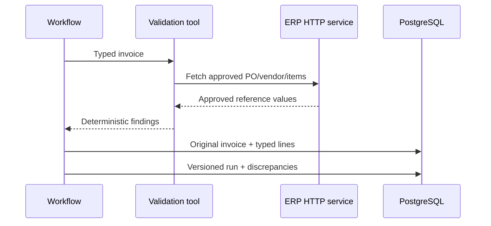

# Member 2: Audit rules and enterprise data

## Your responsibility

Own the typed financial contract, ERP reference service, deterministic audit rules, PostgreSQL persistence and audit-history invariants. You should be able to explain every expected sample discrepancy numerically. Work with Member 1 on parsed fields and Member 4 on correction transactions.

## Read these files in order

1. db/init.sql: erp/audit/langgraph separation, typed NUMERIC columns and append-only run/feedback rows.
2. mock_erp/main.py: vendor, SKU and PO lookups over HTTP.
3. agent/models.py and configs/rules.yaml: typed values, required fields and tolerance/severity policy.
4. agent/validation.py: matching, Decimal calculations and findings.
5. agent/repository.py: original persistence, report versions, concurrency and feedback.
6. agent/corrections.py: validated effective copies.
7. tests/test_validation.py, tests/test_corrections.py, scripts/_storage_probe.py.

## Explain the flow

The model identifies invoice data; it does not decide that a price matches. Deterministic Python rules compare against approved reference data fetched by HTTP. For Spanish, billed price is 120, approved price 100: abs(120-100)/100*100 = 20%. For German, billed quantity 12 versus 10: 20%. Decimal and SQL NUMERIC avoid binary float rounding for money. Line totals, subtotal and tax must remain arithmetically consistent. Missing PO/vendor/item information is a finding rather than permission to approve.

## Your two-minute speech

"My part compares the extracted invoice to trusted ERP data and preserves the audit trail. The ERP is a separate HTTP service, so the agent does not read ERP tables directly. We use Decimal for money and calculate deviations deterministically. Our Spanish sample has a 20% price difference and German has a 20% quantity difference. PostgreSQL stores raw evidence, typed line items, computed findings, report versions and reviewer feedback. A correction makes a new effective input and report; it never rewrites the original. LangGraph checkpoints store execution progress separately from business history."

## Demo you own

Show PO-1001 and its two approved lines: BOX-01 qty10 price100; PAL-01 qty2 price50; EUR. Display English APPROVE and Spanish/German REVIEW findings. Open exported JSON and point out actual/expected/deviation values. Explain why changing only a unit price can create additional arithmetic findings until dependent totals are corrected.

## Three tests to explain

- Correct invoice has no discrepancy; known price/quantity mismatches produce expected deviation and severity.
- Corrections preserve original data; latest feedback applies to an effective copy; stale/invalid values are rejected.
- Isolated Docker normal down/up retains audit rows and LangGraph checkpoints; deleting only the disposable test project's volumes yields a fresh schema with synthetic ERP seed.

Run unit files with `python -m unittest discover -s tests -p test_validation.py -v` and `-p test_corrections.py`. Never run a volume wipe against the working demo project.

## Viva questions

**Why JSONB and typed columns?** Original flexible evidence belongs in JSONB; numeric/reporting operations need typed headers and line rows.

**Checkpoint versus report?** Checkpoint says where execution stopped; report records a business result and its evidence/version.

**Why HTTP ERP?** It enforces the service boundary and allows replacing the mock without coupling agent SQL to ERP tables.

**What if expected amount is zero?** Handle through explicit rule logic; do not divide blindly or fabricate a percentage.

**Why retain failed corrections?** Reviewer intent and pending work must survive failures and be auditable.

**What is not production hardened?** The teaching deployment shares one DB credential; production would add separate least-privilege roles and authenticated ERP access.
