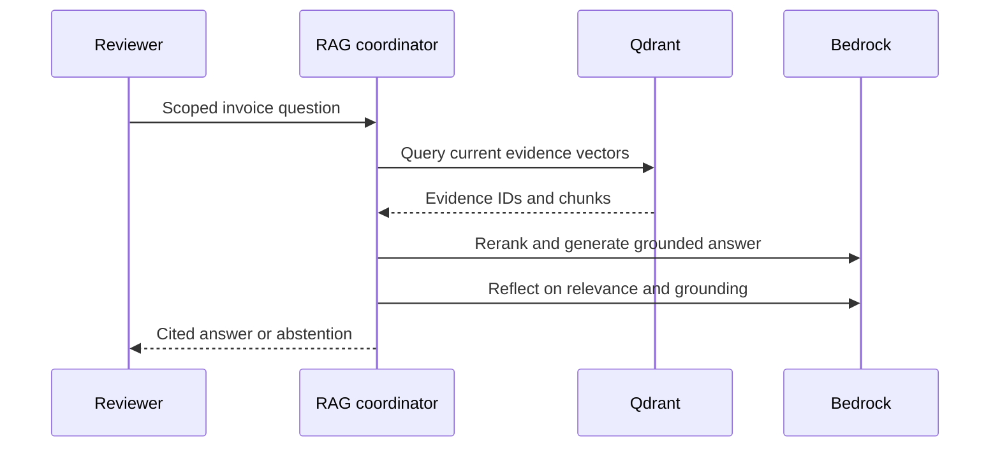

# Member 3: Bedrock and evidence-grounded questions

## Your responsibility

Own chat gateway configuration, embeddings, Qdrant evidence, SQL question routing, reranking, reflection and cache invalidation. You must distinguish retrieval quality from financial validation and explain the temporary Groq versus final Bedrock profiles.

## Read these files in order

1. agent/llm.py and settings.py: lazy ChatBedrockConverse, LiteLLM custom provider, Redis caching and Titan InvokeModel.
2. agent/rag.py: five roles, scoped retrieval, structured SQL intents, reranking and retries.
3. agent/rag_evidence.py: canonical facts instead of generated prose.
4. agent/prompts/answer.txt, reflection.txt and configs/personas.yaml.
5. agent/bedrock_check.py, lab_doctor.py, docs/MODEL_COMPATIBILITY.md.
6. tests/test_bedrock_gateway.py and test_rag_evidence.py; local flow tests for QA behavior.

## Explain the flow

Final chat initialization always goes through ChatBedrockConverse. A small LiteLLM custom provider keeps one in-process gateway. Titan embeddings use InvokeModel because Converse is a chat API. The standard AWS SDK credential chain supports the lab role or approved temporary credentials; keys are not embedded in source. Qdrant vectors are derived from PostgreSQL evidence, while Redis caches are disposable.

The selected invoice/report version limits retrieval scope. Store raw/translated text and canonical report facts, excluding explanation prose to prevent model-written errors becoming evidence. Latest effective correction values take precedence. Structured total/count intents use fixed parameterized SQL. Semantic questions use retrieval, reranking, grounded generation and triad reflection. A mean score strictly greater than 0.7 is required; at most three retries follow the first attempt. Missing evidence leads to abstention.

## Your two-minute speech

"My part lets the reviewer ask questions using saved invoice evidence. We use Bedrock Converse for chat and Titan for embeddings. Qdrant is an index, not our source of truth. For an invoice question we retrieve only relevant current evidence, rerank it and require citations. Reflection checks answer relevance, context relevance and groundedness, with bounded retries. Totals and supported counts use fixed SQL for reliable structured answers. A correction changes the report revision and invalidates old answers. We deliberately exclude generated report prose from canonical evidence, so an earlier wording error cannot become a trusted fact."

## Demo you own

Run credential doctor and live Bedrock check inside the lab agent. Ask Spanish "Which unit price differs?" and show EUR and evidence IDs; ask its invoice total; ask a weather question and show abstention. Display triad scores without calling them probabilities. Explain reindexing from PostgreSQL and disposable cache. Rebuild may make embedding calls and incur lab usage; do it only when needed.

## Three tests to explain

- Actual ChatBedrockConverse through the custom gateway returns a stubbed AWS response without contacting a real account.
- Generated incorrect dollar prose is excluded from report evidence; corrected invoice snapshots supersede original values without mutation.
- Cache scope/report version prevents one invoice's answer or an old correction version from leaking into another answer.

## Viva questions

**Is LiteLLM an OpenAI call?** No. Our registered provider invokes ChatBedrockConverse. Some transitive libraries support other providers, but our final provider is Bedrock.

**Why separate embeddings from Converse?** The Titan embedding model exposes InvokeModel and returns numeric vectors, not a chat message.

**Does a high reflection score guarantee truth?** No; it is a model estimate. We constrain evidence, cite sources and keep deterministic financial checks separate.

**Why no hardcoded AWS keys?** Nuvepro provides runtime identity. Credentials expire and differ by lab; the SDK discovers them and source remains portable.

**Can a model be unavailable?** Yes, permission/region/profile must be checked. The exact retired Command R+ from the brief is disclosed as a compatibility deviation; approved active Bedrock defaults are configurable.

**What remains externally verified?** Live Bedrock entitlement and semantic quality on the Nuvepro account and actual masked dataset.
